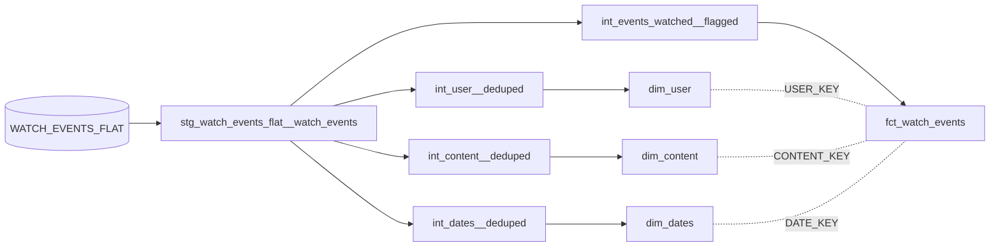

# Streaming Watch Events: CSV to Star Schema

An ELT project that loads a flat streaming-service log into Snowflake and models it into a star schema with dbt.

- **Source:** one CSV, 6,000 watch events, 15 columns, one row per event
- **Load:** Python (pandas + Snowflake connector) into `STREAM_DB.STREAM_SCHEMA.WATCH_EVENTS_FLAT`
- **Transform:** dbt, in three layers: staging, intermediate, marts
- **Output:** one fact table (`fct_watch_events`) and three dimensions (`dim_user`, `dim_content`, `dim_dates`)

## Stack

Snowflake · dbt Core 1.10 (`dbt-snowflake`) · `dbt_utils` · Python 3 (pandas, snowflake-connector-python, python-dotenv)

## Repository layout

```
.
├── raw_data/
│   └── watch_events_flat.csv          # source data
├── stream_ingest_to_warehouse.py      # creates the raw table and loads the CSV
├── requirements.txt
└── stream_analytics/                  # dbt project
    ├── dbt_project.yml
    ├── packages.yml
    ├── analyses/                      # exploratory queries
    └── models/
        ├── staging/                   # source + staging model, contract and tests
        ├── intermediate/              # dedupe and flag logic
        └── marts/
            ├── dimensions/
            └── facts/
```

## Lineage



Only the staging model reads the raw source. Each intermediate model feeds exactly one mart.

## Models

| Layer | Model | Materialized | One row per |
|---|---|---|---|
| Source | `WATCH_EVENTS_FLAT` | raw table | watch event |
| Staging | `stg_watch_events_flat__watch_events` | view | watch event |
| Intermediate | `int_user__deduped` | ephemeral | user per tier |
| Intermediate | `int_content__deduped` | ephemeral | content item |
| Intermediate | `int_dates__deduped` | ephemeral | date |
| Intermediate | `int_events_watched__flagged` | ephemeral | watch event |
| Mart | `dim_user` | table | user per tier (`USER_KEY`) |
| Mart | `dim_content` | table | content item (`CONTENT_KEY`) |
| Mart | `dim_dates` | table | date (`DATE_KEY`) |
| Mart | `fct_watch_events` | table | watch event (`EVENT_ID`) |

**Staging** casts types and trims whitespace. **Intermediate** removes duplicates and applies business rules. **Marts** hold the fact and dimension tables used for analysis.

## Modelling decisions

**1. Subscription tier changes between events.**
The data has 200 users, and 44 of them changed subscription tier during the period. Country never changed. So `dim_user` holds one row per user per tier, which comes to 244 rows. The fact table builds `USER_KEY` from the same columns at the time of each event, so every watch event links to the tier the user was on when it happened.

This is lighter than a full Type 2 slowly changing dimension. There are no `valid_from` / `valid_to` dates, and a user who goes Basic → Premium → Basic reuses the same Basic row.

**2. The completion flag is corrected.**
Some events were marked complete with a lot of the title left unwatched, and others were marked incomplete within a few minutes of the end. `int_events_watched__flagged` recalculates the flag:

- 10 minutes or less left unwatched → completed (`1`)
- more than 10 minutes left unwatched → not completed (`0`)

This changes 827 of the 6,000 events (630 from 0 to 1, and 197 from 1 to 0).

**3. Surrogate keys.**
`USER_KEY` and `CONTENT_KEY` are MD5 hashes generated with `dbt_utils.generate_surrogate_key`. `DATE_KEY` is the date as a `YYYYMMDD` integer.

**4. The date dimension comes from the data.**
`dim_dates` is the union of every content release date and every watch date: 1,005 dates from 2014-01-02 to 2024-06-30. It is not a continuous calendar, so dates with no activity are missing.

## Testing

| Layer | Tests |
|---|---|
| Source | `unique` on `EVENT_ID`; `not_null` on every column except `RATING_GIVEN` |
| Staging | enforced model contract (column names and types); `unique` + `not_null` on `EVENT_ID`; `not_null` on all other columns except `RATING_GIVEN`; `accepted_values` on subscription tier, device type and completion flag |
| Intermediate | `unique` + `not_null` on `CONTENT_ID` and `EVENT_ID`; `not_null` on `USER_ID` |
| Marts | `unique` + `not_null` on every dimension key; `unique` + `not_null` on the fact's `EVENT_ID`; `relationships` tests from each fact key to its dimension |

**Why the relationships tests matter.** The first version of `int_user__deduped` kept one row per user. Every table passed its own tests, but 751 events (12.5%) had a `USER_KEY` with no match in `dim_user`, so they would have dropped out of any join without an error. The fix was `SELECT DISTINCT` on the user columns, and the relationships tests now fail the build if a fact key has no matching dimension row.

## Running it

**1. Install dependencies**

```bash
python -m venv .venv
source .venv/bin/activate
pip install -r requirements.txt
```

**2. Add Snowflake credentials.** Create a `.env` file in the project root (it is gitignored):

```
SNOWFLAKE_USER=
SNOWFLAKE_PASSWORD=
SNOWFLAKE_ACCOUNT=
SNOWFLAKE_WAREHOUSE=
SNOWFLAKE_DATABASE=STREAM_DB
SNOWFLAKE_SCHEMA=STREAM_SCHEMA
```

The database and schema must match `models/staging/source.yml`.

**3. Load the CSV into Snowflake**

```bash
python stream_ingest_to_warehouse.py
```

This creates `WATCH_EVENTS_FLAT` if it doesn't exist and loads the CSV into it.

**4. Set up a dbt profile.** Add this to `~/.dbt/profiles.yml`, which sits outside the repo:

```yaml
stream_analytics:
  target: dev
  outputs:
    dev:
      type: snowflake
      account: "{{ env_var('SNOWFLAKE_ACCOUNT') }}"
      user: "{{ env_var('SNOWFLAKE_USER') }}"
      password: "{{ env_var('SNOWFLAKE_PASSWORD') }}"
      warehouse: "{{ env_var('SNOWFLAKE_WAREHOUSE') }}"
      database: STREAM_DB
      schema: STREAM_SCHEMA
      threads: 4
```

dbt does not read `.env` by itself, so export the variables first:

```bash
set -a; source .env; set +a
```

**5. Build and test**

```bash
cd stream_analytics
dbt deps
dbt build
```

`dbt build` runs every model and test in dependency order.

**6. Browse the docs and lineage graph (optional)**

```bash
dbt docs generate
dbt docs serve
```

## Data notes

- Watch dates run from 2022-06-28 to 2024-06-30.
- 400 content items, each with fixed attributes.
- `RATING_GIVEN` is blank for 4,528 of 6,000 events (75%), so any rating analysis covers only about a quarter of events.

## Next steps

- Build `dim_dates` from a date spine (`dbt_utils.date_spine`) so the calendar has no gaps.
- Add `valid_from` / `valid_to` to `dim_user` to make it a full Type 2 dimension.
- Keep the original completion flag as `COMPLETED_FLAG_RAW`, and make the 10-minute threshold a dbt variable.
- Add uniqueness tests on the grain of `int_user__deduped` and `int_dates__deduped`.
- Make `fct_watch_events` incremental on `WATCH_DATE`.

## Author

Daniel Agbenyo · [LinkedIn](#) · [X](#)
